<p align="center">
  
</p>

<p align="center">
  <b>The website for Blendon - Blender-style Scene view navigation, transform gizmos and pie menus for the Unity Editor.</b>
</p>

<p align="center">
  React 19 &nbsp;·&nbsp; TypeScript &nbsp;·&nbsp; Vite &nbsp;·&nbsp; static, prerendered, deployed to GitHub Pages
</p>

<p align="center">
  <a href="https://blendon.drygiel.com"><b>Live site</b></a> &nbsp;·&nbsp;
  <a href="https://blendon.drygiel.com/playground/">Playground</a> &nbsp;·&nbsp;
  <a href="https://blendon.drygiel.com/docs/Blendon_Manual.pdf">User Manual (PDF)</a> &nbsp;·&nbsp;
  <a href="https://assetstore.unity.com/packages/slug/415610">Asset Store</a> &nbsp;·&nbsp;
  <a href="#getting-started">Getting started</a> &nbsp;·&nbsp;
  <a href="#deployment">Deployment</a>
</p>

<p align="center">
  <a href="https://blendon.drygiel.com">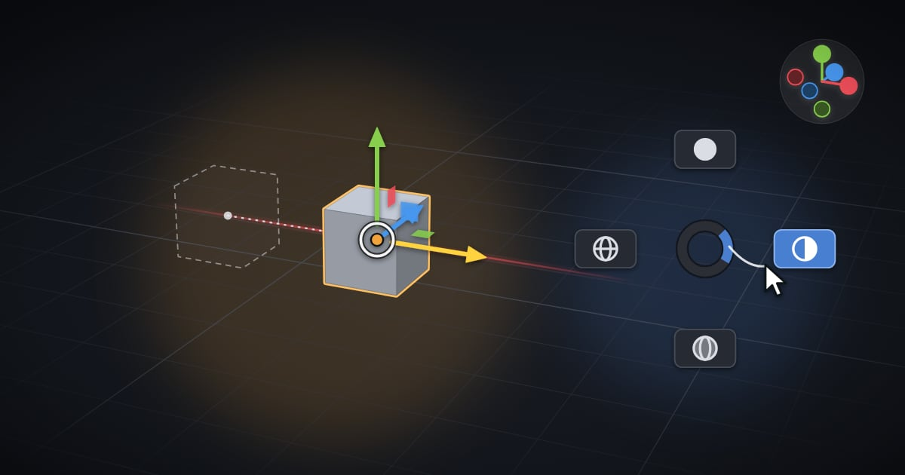</a>
</p>

This repository is mounted as a Git submodule at `Web~/` in the main [Blendon](https://github.com/drygiel/Blendon)
repository. Unity skips folders ending with `~`, so nothing here (including `node_modules`) is imported into the
project.

---

## What's on the site

- **A working Scene view in the browser.** The Playground runs Blendon's navigation, gizmos and pie menus on a real 3D
  scene, so you can try the keys before buying. The landing page embeds the same dock in its _Try it_ section.
- **The real settings window.** The window is rebuilt from the plugin's own `DrawSettings` code and a dump of the Unity
  Editor, so every page, label, tooltip and default matches the asset. Changing a setting changes the Scene view next
  to it.
- **A clip for every feature.** Eighteen short loops in the tooltip style, the same ones the plugin's tooltip cards use.
- **The tour.** Promo video, what changes against stock Unity, features, precision tools, pie menus, the in-editor
  tutorial, setup, feature presets, shortcuts, under the hood, FAQ.
- **Static and fast.** Prerendered landing with JSON-LD, the Scene view and the window load as their own chunks when
  they come near, and every animation stops under `prefers-reduced-motion`.

---

## Navigation

<table>
<tr>
<td width="50%" valign="top">
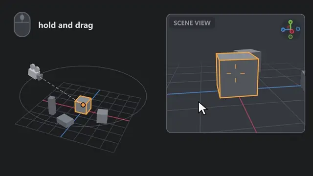
<br><b>Orbit Selected</b> &nbsp; <kbd>MMB</kbd> drag<br>
Orbit around the selection. Hold <kbd>Alt</kbd> to snap to a world axis, flick <kbd>Alt</kbd> + <kbd>MMB</kbd> to roll 90°.
</td>
<td width="50%" valign="top">
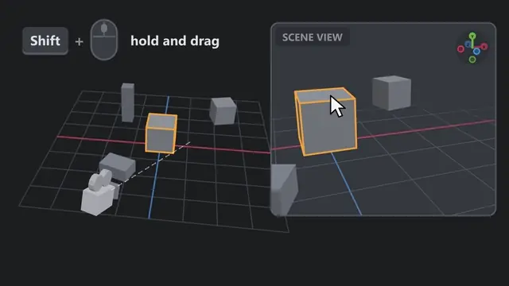
<br><b>Camera Pan</b> &nbsp; <kbd>Shift</kbd> + <kbd>MMB</kbd><br>
The point under the cursor stays under the cursor, and the drag wraps past the view edge.
</td>
</tr>
<tr>
<td width="50%" valign="top">
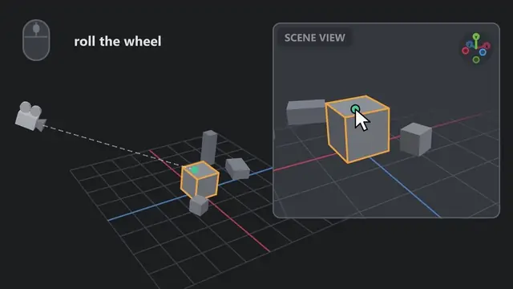
<br><b>Zoom</b> &nbsp; <kbd>Scroll</kbd> &nbsp; <kbd>Numpad +</kbd> <kbd>Numpad -</kbd><br>
Blender's Scale, Dolly and Continue methods, toward the cursor.
</td>
<td width="50%" valign="top">
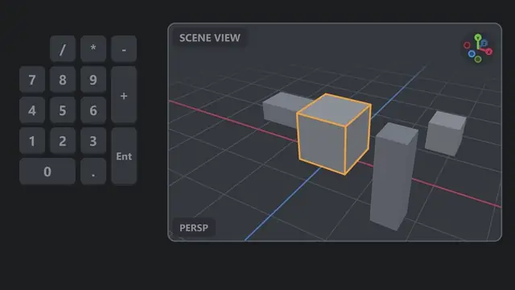
<br><b>Numpad Views</b> &nbsp; <kbd>1</kbd> <kbd>3</kbd> <kbd>7</kbd> <kbd>5</kbd> <kbd>0</kbd><br>
Axis views, perspective toggle, orbit steps, reverse view and looking through the camera.
</td>
</tr>
<tr>
<td width="50%" valign="top">
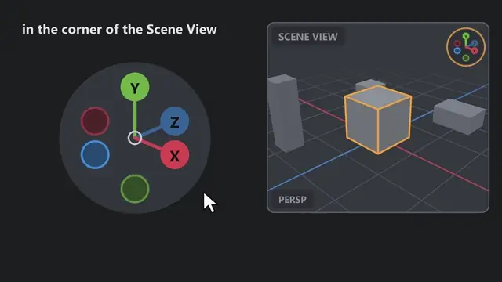
<br><b>Orientation Gizmo</b><br>
Blender's axis ball in the corner. Click an axis to look down it, drag to orbit, middle-click to toggle perspective.
</td>
<td width="50%" valign="top">
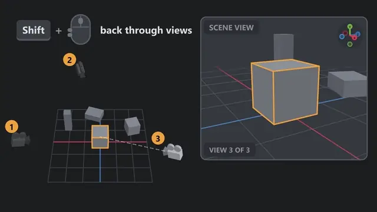
<br><b>View History</b> &nbsp; <kbd>Shift</kbd> + <kbd>Mouse 3</kbd> / <kbd>Mouse 4</kbd><br>
Back and forward through camera positions, like a browser.
</td>
</tr>
<tr>
<td width="50%" valign="top">
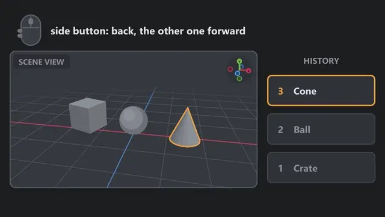
<br><b>Selection History</b> &nbsp; <kbd>Mouse 3</kbd> / <kbd>Mouse 4</kbd><br>
The same for selections: step back to what you had selected a moment ago.
</td>
<td width="50%" valign="top">
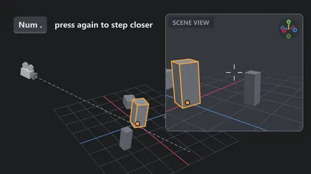
<br><b>Frame Selected</b> &nbsp; <kbd>Numpad .</kbd><br>
Each press steps on: the selection, its pivot, a close-up, then back to where you started.
</td>
</tr>
</table>

---

## Transform Gizmos

Blender-style **Move**, **Rotate**, **Scale** and **Transform** gizmos. Each one can be switched off on its own and
falls back to Unity's gizmo. All of them honor Pivot/Center and Local/Global, work with multi-selection and Unity's grid
snapping, and cancel on right-click.

<table>
<tr>
<td width="50%" valign="top">
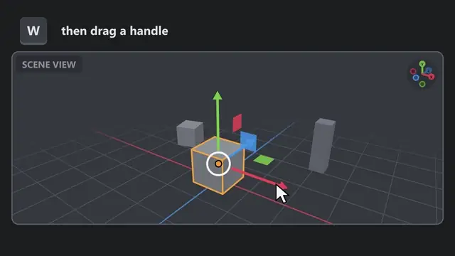
<br><b>Move</b> &nbsp; <kbd>W</kbd><br>
Arrows, plane handles and a free-move ring. Hold <kbd>Alt</kbd> to drop the selection onto the surface under the cursor.
</td>
<td width="50%" valign="top">
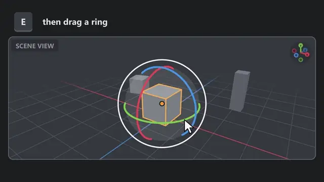
<br><b>Rotate</b> &nbsp; <kbd>E</kbd><br>
Rings that follow the cursor, a trackball and an angle arc. Hold <kbd>Alt</kbd> to aim the selection at a surface.
</td>
</tr>
<tr>
<td width="50%" valign="top">
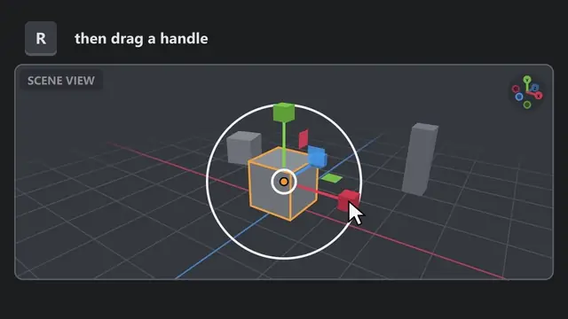
<br><b>Scale</b> &nbsp; <kbd>R</kbd><br>
Box-tipped axes, plane handles and a uniform-scale circle, with Blender's Global/Local behavior.
</td>
<td width="50%" valign="top">
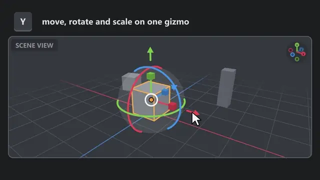
<br><b>Transform</b> &nbsp; <kbd>Y</kbd><br>
All three in one, nested so they never fight.
</td>
</tr>
<tr>
<td width="50%" valign="top">
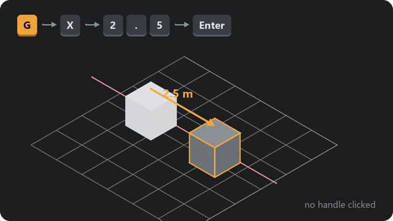
<br><b>Grab and type</b> &nbsp; <kbd>G</kbd> <kbd>R</kbd> <kbd>S</kbd><br>
No handle to click. Constrain with <kbd>X</kbd> <kbd>Y</kbd> <kbd>Z</kbd>, type an exact value, confirm with <kbd>Enter</kbd>. Typing works mid-drag on any handle too.
</td>
<td width="50%" valign="top">
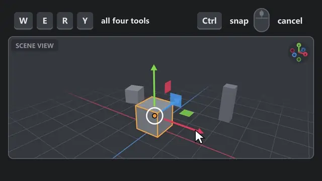
<br><b>Drag feedback</b><br>
Live readout, drag ghost, constraint line and snap ticks. Hold <kbd>Shift</kbd> for a slow, precise drag.
</td>
</tr>
<tr>
<td width="50%" valign="top">
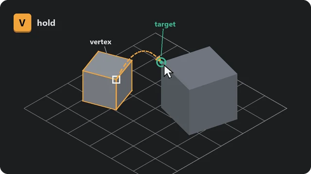
<br><b>Vertex snapping</b> &nbsp; hold <kbd>V</kbd> &nbsp; <kbd>Shift</kbd> + <kbd>V</kbd><br>
Snap a vertex onto another object's vertex, or pick any vertex as a virtual pivot. Skinned meshes included.
</td>
<td width="50%" valign="top">
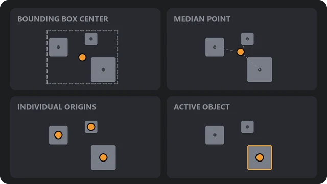
<br><b>Pivot Point</b><br>
Unity's Pivot/Center dropdown gains Blender's four pivot modes, for both rotating and scaling.
</td>
</tr>
</table>

---

## Scene Tools and Menus

<table>
<tr>
<td width="50%" valign="top">
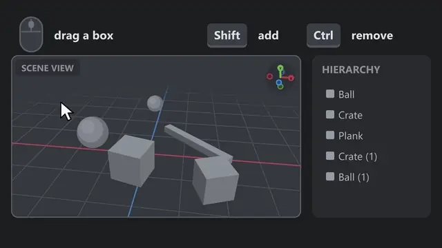
<br><b>Box Select</b> &nbsp; <kbd>LMB</kbd> drag<br>
Selects everything the box touches, tested against real triangles. <kbd>C</kbd> includes hidden objects, <kbd>Space</kbd> moves the box.
</td>
<td width="50%" valign="top">
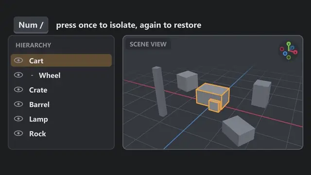
<br><b>Isolate View</b> &nbsp; <kbd>Numpad /</kbd><br>
Hides everything but the selection. Press again to bring the scene back.
</td>
</tr>
<tr>
<td width="50%" valign="top">
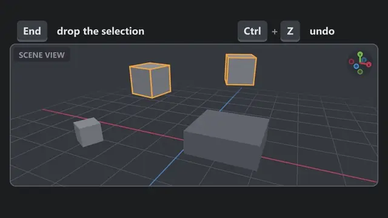
<br><b>Snap to Floor</b> &nbsp; <kbd>End</kbd><br>
Drops the selection onto whatever is below it, optionally aligned to the slope.
</td>
<td width="50%" valign="top">
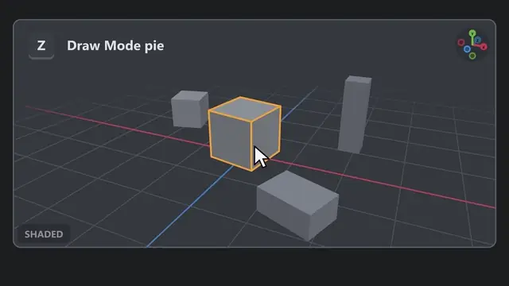
<br><b>Pie Menus</b> &nbsp; <kbd>Z</kbd> <kbd>Q</kbd> <kbd>Shift</kbd> + <kbd>A</kbd> ...<br>
Hold, flick, let go, or tap to keep it open. Eight built-in pies, plus a visual editor for your own.
</td>
</tr>
<tr>
<td width="50%" valign="top">
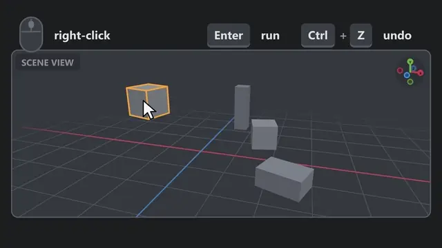
<br><b>Context Menu</b> &nbsp; <kbd>RMB</kbd><br>
Searchable, holds every entry Unity's menu has, plus Add, Snap to Floor, Align and Copy Transform.
</td>
<td width="50%" valign="top">
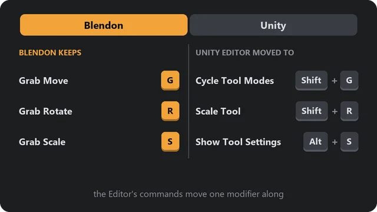
<br><b>Keyboard presets</b><br>
<b>Blendon</b> keeps the Blender keys and moves Unity's commands one modifier along. <b>Unity</b> leaves the Editor's keys alone.
</td>
</tr>
</table>

The clips above are animated WebP copies of `public/plugin/video/*.mp4` (see [README clips](#readme-clips)). The stills
come straight from `public/plugin/`, so this page needs nothing outside the repository.

---

## Getting started

Requirements:

- Node 24 LTS (see `.nvmrc`; Node 22.12+ also works)
- pnpm 12, pinned in `package.json` - run `corepack enable` once and the right version is used automatically. An
  older pnpm rewrites `pnpm-lock.yaml` in its own format, which CI then rejects.

```bash
corepack enable
pnpm install
pnpm dev
```

Playwright needs its browsers once: `pnpm exec playwright install`.

### Scripts

| Command          | What it does                                                  |
| ---------------- | ------------------------------------------------------------- |
| `pnpm install`   | Install dependencies                                          |
| `pnpm dev`       | Dev server with hot reload                                    |
| `pnpm build`     | Type-check, build the static site into `dist/` and prerender  |
| `pnpm prerender` | Render the landing and its JSON-LD into `dist/index.html`     |
| `pnpm preview`   | Serve the production build locally                            |
| `pnpm check`     | Type-check, lint, format check and unit tests (what CI runs)  |
| `pnpm test`      | Unit tests (Vitest)                                           |
| `pnpm test:e2e`  | End-to-end tests in Chromium, Firefox and WebKit (Playwright) |
| `pnpm format`    | Format everything with Prettier                               |

## Stack

React 19, TypeScript (strict), Vite, SCSS (CSS Modules), Vitest, Playwright, ESLint and Prettier. No CSS framework.

## Settings window data

The site shows Blendon's settings window, rebuilt from the plugin itself. `pnpm sync` reads the plugin this repository
is mounted in (`../`, or `BLENDON_DIR`):

- `Editor/**/*Settings.cs` - each page's `DrawSettings` code, turned into the window's layout
- `Editor/Icons` - tooltip images, page header images and Blendon's own icons
- `Metadata~/PlaygroundRef` - labels, tooltips, defaults and constants plus the Editor's built-in icons, dumped from
  the Unity Editor (`model*.json`, `ui/`)
- `Metadata~/Video` - the feature clips
- `Documentation/Blendon_Manual.pdf` - the manual the page links to

It writes `src/plugin/generated/` (`window-data.json`, `tutorial.json`), `public/plugin/` and `public/docs/`. Both are
committed, so CI never needs the plugin. Run it after changing the plugin's settings pages, then commit the result.

### Refreshing the Unity dump

`Metadata~/PlaygroundRef` holds what only a running Editor can answer: labels, tooltips and defaults resolved through
the settings classes, the shortcut tables, the pie menus, and the built-in icons. When those change:

1. Copy `tools/unity/BlendonWebExport.cs` into any `Editor` folder of the Unity project.
2. Run **Tools > Blendon > Export Web Data**. It rewrites `Metadata~/PlaygroundRef` (`model*.json`, `ui/`).
3. Delete the copied script, then run `pnpm sync` and commit.

The exporter reads Blendon only through reflection, so it compiles in any assembly and changes no settings.

### README clips

GitHub does not play an `.mp4` linked by a relative path, so the animations on this page are animated WebP files in
`.github/readme/`, outside `public/` so they never ship with the site. After `pnpm sync` brings new clips, rebuild them
with ffmpeg:

```bash
for f in public/plugin/video/*.mp4; do ffmpeg -v error -y -i "$f" -vf "fps=25,scale=640:-1:flags=lanczos" -c:v libwebp_anim -quality 70 -compression_level 6 -loop 0 ".github/readme/$(basename "$f" .mp4).webp"; done
```

## Layout

| Path                      | Contents                                                                         |
| ------------------------- | -------------------------------------------------------------------------------- |
| `src/landing/`            | The landing page: one folder per section under `sections/`, shared bits in `ui/` |
| `src/landing/plotter/`    | The background plotter; `contract.ts` lists what the page marks up for it        |
| `src/playground/`         | The Playground page and its dock, which the landing's Try It section embeds too  |
| `src/scene/`              | The Scene view running Blendon, loaded as its own chunk                          |
| `src/window/`             | The settings window, loaded as its own chunk when its section comes near         |
| `src/window/core/`        | Layout builder, settings model and helpers - plain TypeScript, unit-tested       |
| `src/window/gizmo/`       | The 3D gizmo preview, a port of the plugin's `GizmoPreview` to canvas            |
| `src/window/styles/`      | The window's styles, scoped under `.uw`                                          |
| `src/bridge/`             | What the Scene view and the settings window share: settings and events           |
| `src/plugin/`             | Data from the plugin: `pnpm sync` output in `generated/` and its typed loaders   |
| `src/lib/`                | Small helpers every part uses                                                    |
| `scripts/sync/`           | `pnpm sync`: reads the plugin's C# sources and the Unity dump                    |
| `src/entry-server.tsx`    | `pnpm prerender`'s server entry; `scripts/prerender.ts` writes its output        |
| `tools/unity/`            | The Unity-side exporter for `Metadata~/PlaygroundRef`                            |
| `.github/readme/`         | Animated WebP clips for this README                                              |
| `tests/unit`, `tests/e2e` | Vitest and Playwright suites                                                     |

Animations stop under `prefers-reduced-motion`: the hero holds still, clips don't autoplay and the gizmo preview
stops turning.

